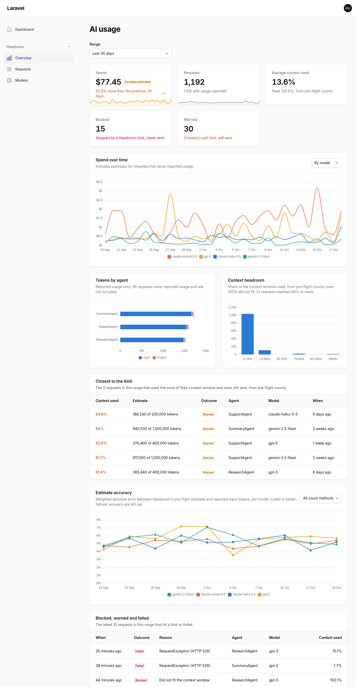
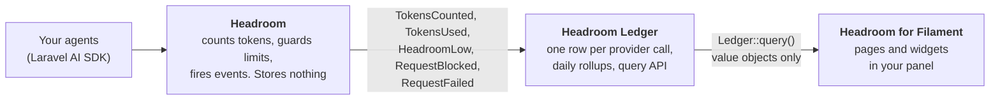

# Headroom for Filament

A Filament dashboard for AI token usage, cost and context limits, powered by [Headroom](https://github.com/phoenix1331/laravel-ai-headroom).

[](https://github.com/phoenix1331/filament-headroom/actions/workflows/tests.yml)
[](https://github.com/phoenix1331/filament-headroom/actions/workflows/static-analysis.yml)
[](LICENSE)

<picture>
  <source media="(prefers-color-scheme: dark)" srcset="docs/screenshots/overview-dark.png">
  
</picture>

Spend and its trend, tokens by agent, how close requests came to their context window, how accurate the estimates were, and every request and agent run, inside the Filament panel your team already uses. It reads the [Headroom Ledger](https://github.com/phoenix1331/laravel-ai-headroom-ledger), stores nothing itself, and never shows an estimate as billed cost.

**Site:** <https://phoenix1331.github.io/filament-headroom>

## What this demonstrates

- **The pre-flight side of AI spend.** Headroom counts every request before it is sent, so the dashboard shows what was predicted as well as what was billed: estimate error per model and count method, requests that crept towards their context limit, and requests warned or blocked before they could cost anything.
- **Honest numbers.** Every cost carries its basis. A pre-flight estimate is badged "Estimate", a total with estimates in it "Includes estimates", and cache tokens that could not be priced exactly "Approximate". Currencies are never added together or converted.
- **A plugin built only on a public query API.** Every figure comes from the ledger's typed query API (`Ledger::query()`, value objects, no Eloquent models), enforced by an architecture test. Gaps found while building it went back to the ledger as API changes rather than workarounds.
- **Multi-tenancy that fails closed.** One option scopes every page, widget, filter option, agent run and detail view to the current Filament tenant, with tests that check each of them for leaks.

## How the packages fit together



| Package | Role |
|---|---|
| [`phoenix1331/laravel-ai-headroom`](https://github.com/phoenix1331/laravel-ai-headroom) | Counts tokens before a request is sent, guards context and cost limits, calibrates its estimates, fires events |
| [`phoenix1331/laravel-ai-headroom-ledger`](https://github.com/phoenix1331/laravel-ai-headroom-ledger) | Records those events, one row per provider call, and answers questions through a typed query API |
| `phoenix1331/filament-headroom` | This package: the dashboard over the ledger |

Installing this plugin installs the other two.

## Tech stack and compatibility

| | |
|---|---|
| PHP | 8.3, 8.4, 8.5 |
| Laravel | 12, 13 |
| Filament | 5 (Livewire 4) |
| Headroom | ^0.1 |
| Headroom Ledger | ^0.1.1 |
| Databases | Whatever the ledger supports: SQLite, PostgreSQL, MySQL, MariaDB |

CI tests every PHP and Laravel combination above, at both the lowest and the newest dependency versions.

## Getting started

### Requirements

- A Laravel 12 or 13 app with a Filament 5 panel
- Agents built on the [Laravel AI SDK](https://github.com/laravel/ai) and guarded by Headroom (see [Headroom's README](https://github.com/phoenix1331/laravel-ai-headroom)); the dashboard shows whatever the ledger has recorded
- A queue worker, or `HEADROOM_LEDGER_QUEUE_CONNECTION=sync`, so the ledger records requests
- The Laravel scheduler running, for the ledger's daily rollups and pruning

### Install

1. Require the plugin (Headroom and the ledger come with it):

   ```bash
   composer require phoenix1331/filament-headroom
   ```

2. Create the ledger tables:

   ```bash
   php artisan vendor:publish --tag=headroom-ledger-migrations
   php artisan migrate
   ```

3. Register the plugin on your panel and say who may see it:

   ```php
   use Phoenix1331\FilamentHeadroom\HeadroomPlugin;

   public function panel(Panel $panel): Panel
   {
       return $panel
           // ...
           ->plugin(
               HeadroomPlugin::make()
                   ->authorize(fn ($user): bool => $user->isAdmin()),
           );
   }
   ```

4. Publish the plugin's stylesheet with Filament's assets:

   ```bash
   php artisan filament:assets
   ```

A **Headroom** group appears in your panel's navigation with these pages:

| Page | Path | Shows |
|---|---|---|
| Overview | `/{panel}/headroom` | Range picker and every enabled widget |
| Requests | `/{panel}/headroom/requests` | Every ledger entry, paginated, sorted and filtered by the ledger; "Group by run" for agent runs |
| Request detail | `/{panel}/headroom/requests/{requestId}` | Estimate against reported tokens, input breakdown, cost with its basis, and each step of the agent run with its context growth |
| Models | `/{panel}/headroom/models` | Per model: spend, context, blocked and warned counts, estimate error and bias, calibration status |

## Configuration

Every option is a fluent method on the plugin. Closures work wherever the value depends on the request.

```php
use Phoenix1331\FilamentHeadroom\HeadroomPlugin;
use Phoenix1331\FilamentHeadroom\Pages\Overview;
use Phoenix1331\FilamentHeadroom\Pages\Requests;
use Phoenix1331\FilamentHeadroom\Widgets\SpendOverTime;
use Phoenix1331\FilamentHeadroom\Widgets\StatsOverview;

HeadroomPlugin::make()
    ->authorize(fn ($user): bool => $user->can('viewAiUsage'))
    ->navigationGroup('Monitoring')                         // null for no group
    ->navigationSort(20)                                    // moves the whole Headroom block
    ->navigationIcon('heroicon-o-cpu-chip', Overview::class) // every page, or one page
    ->defaultRange('7d')                                    // '7d', '30d' or '90d'
    ->tagLabel(fn (string $key, string $value): string => $key === 'tenant_id'
        ? Team::find($value)?->name ?? $value
        : $value)
    ->widgets([StatsOverview::class, SpendOverTime::class]) // replaces the built-in list
    ->pages([Overview::class, Requests::class])             // pass a subclass to customise one
    ->scopeToTenant('tenant_id')
    ->allowForgettingTags(fn ($user): bool => $user->isSuperAdmin());
```

| Option | Default | Notes |
|---|---|---|
| `authorize(bool\|Closure)` | Visible only in `local` | The closure receives `$user` and must return exactly `true`; anything else denies |
| `navigationGroup()` | "Headroom" (translated) | |
| `navigationIcon($icon, ?$page)` | Each page's own icon | |
| `navigationSort()` | Each page's own order | A base: pages keep their order within the block |
| `defaultRange()` | `30d` | An unsupported value throws when the panel boots, not when a page renders |
| `tagLabel(Closure)` | `key: value` | Used in filters, columns and the detail view |
| `widgets(array)` | All seven | Disabled widgets are left off the Overview and hidden everywhere on the panel |
| `pages(array)` | Overview, Requests, Models | The detail page follows the Requests page |
| `scopeToTenant($tag, ?Closure)` | Off | See [Multi-tenancy](#multi-tenancy) |
| `allowForgettingTags(bool\|Closure)` | Off | See [Data subject requests](#data-subject-requests) |

### Widgets on your own dashboards

Every widget works on any Filament dashboard and follows the plugin's authorisation (or the local-only default on a panel without the plugin). Add the range picker to the dashboard's filters form and they follow it:

```php
use Filament\Pages\Dashboard as BaseDashboard;
use Filament\Pages\Dashboard\Concerns\HasFiltersForm;
use Filament\Schemas\Schema;
use Phoenix1331\FilamentHeadroom\Support\RangeSelect;

class Dashboard extends BaseDashboard
{
    use HasFiltersForm;

    public function filtersForm(Schema $schema): Schema
    {
        return $schema->components([RangeSelect::make()]);
    }
}
```

Widgets: `StatsOverview`, `SpendOverTime`, `TokensByAgent`, `ContextHeadroom`, `ClosestToLimit`, `EstimateAccuracy` and `BlockedWarnedFailed`, all in `Phoenix1331\FilamentHeadroom\Widgets`.

### Multi-tenancy

On a panel with Filament tenancy, scope everything to the current tenant through a ledger context tag:

```php
HeadroomPlugin::make()->scopeToTenant('tenant_id');                                      // the tenant's key
HeadroomPlugin::make()->scopeToTenant('team', fn (Team $tenant): string => $tenant->uuid); // or any value you tag with
```

Record the tag on every request with `Headroom::resolveContextUsing()` and add it to the ledger's `tags.allowed` list (making it the `primary_tag` keeps per-tenant queries on the daily rollups). Every page, widget, filter option, agent run and detail view then reads only the current tenant. A request from another tenant is a 404, and with no current tenant nothing matches.

### Data subject requests

`allowForgettingTags()` adds a "Forget a tag value" action to the Requests page. After confirmation it calls the ledger's `forgetTag()`, which erases the value everywhere, clears it from rollups and gives the affected agent runs new IDs. It is off by default, authorised separately from the dashboard, and never offered under tenant scoping: the ledger erases a value across every tenant, so one tenant could otherwise erase another's data.

### Translations

Every string is in `resources/lang/en`. Publish the files to edit them or add a language:

```bash
php artisan vendor:publish --tag=filament-headroom-translations
```

## Environment variables

The plugin has none of its own. These ledger and Headroom settings change what it shows:

| Key | Default | Description |
|---|---|---|
| `HEADROOM_LEDGER_ENABLED` | `true` | Turns recording off; the dashboard then shows only what is already stored |
| `HEADROOM_LEDGER_QUEUE_CONNECTION` | app default | Queue for recording; `sync` records inline without a worker |
| `HEADROOM_LEDGER_DB_CONNECTION` | app default | Database connection for the ledger tables |
| `HEADROOM_LEDGER_TABLE_PREFIX` | `headroom_ledger_` | Ledger table name prefix |
| `HEADROOM_CALIBRATION` | `true` | Headroom's self-calibration, shown as each model's calibration status on the Models page |

## Architecture notes

- **Read-only, through the query API.** The plugin has no migrations and no models. `HeadroomPlugin::ledger()` is the one starting point for every read, which is where tenant scoping is applied, and an architecture test forbids the `DB` facade and the ledger's models. The ledger's schema can change without breaking the dashboard.
- **Tables over a query API.** Filament tables normally sit on Eloquent. Here they take array records from the ledger's `paginate()`, with sorting mapped to its `EntrySort` enum, so paging and sorting happen in the database without the plugin knowing a column name.
- **Charts that can be trusted.** Chart colours are a fixed categorical palette checked for colour vision deficiency on Filament's light and dark surfaces, assigned by series name so a model keeps its colour when rankings change. Lines that would mix currencies are never drawn: the largest currency is charted and the others are named.
- **Fail closed everywhere.** Authorisation defaults to local only, accepts only an exact `true`, and is checked when a widget mounts and on every later request. Tenant scoping without a tenant matches nothing.
- **Built against real traffic.** Beyond a Pest suite at 99% line coverage, the dashboard was checked in a Laravel docs RAG app answering questions through Gemini, against the ledger's own `headroom-ledger:report`.

## Contributing

See [CONTRIBUTING.md](CONTRIBUTING.md). In short: `composer install`, `npm install` (activates the Git hooks; [`osv-scanner`](https://github.com/google/osv-scanner) must be on your `PATH` for the pre-commit check), `composer build`, `composer serve`, and `composer check` before a pull request.

## Security

See [SECURITY.md](SECURITY.md) for what the dashboard exposes, the authorisation defaults and how to report a vulnerability privately.

## Licence

MIT. See [LICENSE](LICENSE).
